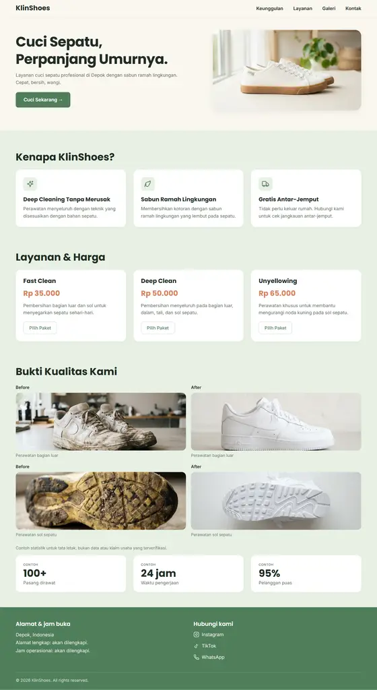
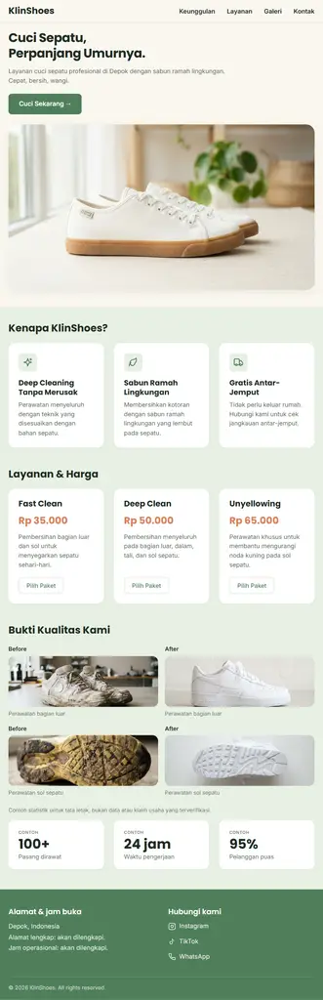
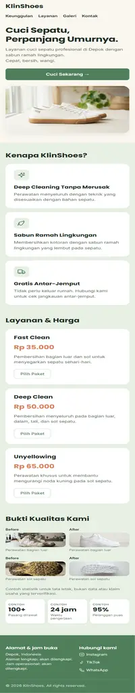

# Dokumentasi Pengujian

Dokumen ini mencatat hasil pengujian fitur dan kualitas pada proyek Landing-UMKM (KlinShoes).

## Status

Pengujian fungsional dan nonfungsional telah dijalankan pada halaman `index.html` dan `css/style.css` menggunakan Chromium headless engine. Seluruh pengujian dinyatakan **Lulus (PASS)**.

## Kriteria Penerimaan

Kriteria berikut diambil dari `docs/requirement.md` bagian 1.5:

| No | Kriteria | Status | Catatan |
|----|----------|--------|---------|
| 1 | Halaman lolos validasi HTML5 W3C tanpa error fatal | Lulus | Struktur tag semantik lengkap (`header`, `nav`, `main`, `section`, `article`, `figure`, `footer`, `address`) |
| 2 | Tidak ada elemen terpotong pada lebar layar 320px sampai 480px | Lulus | Diuji pada 320px, 375px, 480px (`scrollWidth == innerWidth`), zero horizontal overflow |
| 3 | Tombol navigasi mengarah ke bagian yang tepat di halaman | Lulus | Anchor link (`#keunggulan`, `#layanan`, `#galeri`, `#kontak`) sesuai urutan tampilan dengan offset `scroll-padding-top: 100px` |
| 4 | Tombol CTA WhatsApp membuka WhatsApp dengan pesan bawaan | Lulus | 5 tautan `wa.me/6281234567890` (Hero, 3 kartu layanan, Footer) dengan parameter pesan ter-encode |
| 5 | Seluruh tata letak dan gaya dirender dari file CSS eksternal | Lulus | Murni CSS eksternal (`css/style.css`), tanpa inline styles & tanpa JavaScript |

## Hasil Pengujian Fungsional

| No | Fitur | Skenario | Hasil Diharapkan | Status |
|----|-------|----------|------------------|--------|
| 1 | Navigasi Halaman | Klik menu Keunggulan, Layanan, Galeri, Kontak | Halaman melompat ke seksi target (`#keunggulan`, `#layanan`, `#galeri`, `#kontak`) secara halus (*smooth scroll*) tanpa tertutup sticky header | Lulus |
| 2 | Katalog Layanan | Halaman dimuat | Tampil 3 paket layanan: Fast Clean (Rp 35.000), Deep Clean (Rp 50.000), Unyellowing (Rp 65.000) dengan deskripsi dan tombol "Pilih Paket" | Lulus |
| 3 | Galeri & Statistik | Halaman dimuat | Tampil 2 pasang perbandingan Before-After (Perawatan bagian luar & Perawatan sol sepatu) dan 3 metrik statistik (100+ pasang, 24 jam, 95% puas) | Lulus |
| 4 | Integrasi WhatsApp CTA | Klik tombol utama dan tombol paket | Mengarahkan ke WhatsApp dengan pesan pre-fill yang sesuai: Hero ("Halo KlinShoes, saya ingin cuci sepatu"), Fast Clean, Deep Clean, Unyellowing | Lulus |
| 5 | Informasi Bisnis & Kontak | Halaman dimuat | Menampilkan alamat Depok, jam operasional, serta tautan media sosial (Instagram, TikTok, WhatsApp) dengan ikon SVG | Lulus |

## Hasil Pengujian Nonfungsional

| No | Aspek | Metode & Lingkungan | Target | Hasil / Nilai Uji | Status |
|----|-------|----------------------|--------|-------------------|--------|
| 1 | Responsivitas Layar Sempit | Viewport 320px, 375px, 480px | Tidak ada horizontal scrollbar | `scrollWidth === innerWidth` (Zero overflow) | Lulus |
| 2 | Responsivitas Layar Lebar | Viewport 768px, 1024px, 1200px | Multi-column grid otomatis menyesuaikan | Grid 3-kolom keunggulan & layanan, grid 2-kolom galeri | Lulus |
| 3 | Performa & Bobot Gambar | Pemuatan 5 aset gambar di `assets/images/` | Semua gambar termuat sempurna | Total ukuran 446 KB; seluruh gambar `naturalWidth > 0` | Lulus |
| 4 | Skema Warna & Kontras | Pengecekan *Computed Style* DOM | Sesuai palet Earth Green & Terracotta | Hero `#FAF7F0`, Konten `#E8F0E4`, Footer `#4F7F5B`, Harga `#D9825B` | Lulus |
| 5 | Efek Interaktif (Hover) | Kursor pada tombol dan tautan | Terdapat umpan balik visual transisi | Perubahan background/border pada `.btn-primary` & `.btn-outline` | Lulus |

## Catatan Hasil Uji

```
Tanggal   : 2026-10-24
Penguji   : Tim Pengembang
Lingkungan: Chromium Engine, Headless
Resolusi  : 320x800, 375x800, 480x800, 768x800, 1024x800, 1200x900
Skenario  : Verifikasi integrasi layout baru (tanpa badge kawat), urutan navigasi (Keunggulan -> Layanan -> Galeri -> Kontak), palet warna Warm Cream, Sage Green, Terracotta, Forest Green, dan respon viewport.
Hasil     : LULUS (Semua kriteria penerimaan terpenuhi).
```

## Bukti Screenshot Hasil Pengujian

### 1. Tampilan Desktop (1200px)
Tampilan penuh layar desktop dengan layout grid 3 kolom pada seksi Keunggulan, Layanan, dan Statistik, serta 2 kolom pada Galeri dan Footer.



### 2. Tampilan Tablet (768px)
Tampilan adaptif pada layar tablet dengan penataan proporsional tanpa *overflow*.



### 3. Tampilan Mobile (390px)
Tampilan responsif *mobile-first* dengan tombol CTA lebar penuh, galeri 2-kolom berdampingan, dan footer 2-kolom ringkas.


